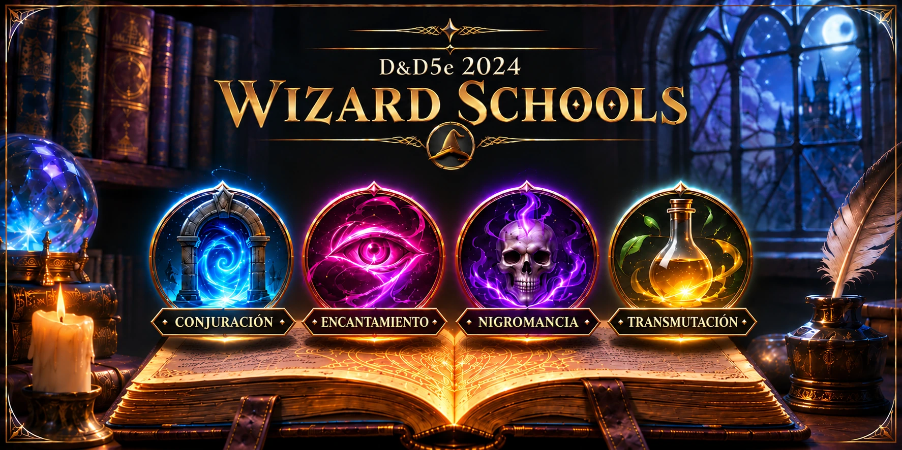
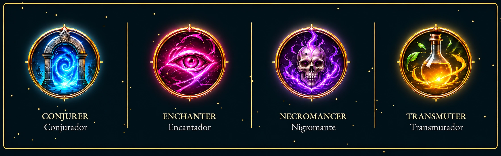

# D&D 2024 — Escuelas de magia de mago

**Español** | [English](README.en.md)


[](https://github.com/foundryvtt-sinregistrar/dnd5e-2024-wizard-schools/releases/latest)
[](https://github.com/foundryvtt-sinregistrar/dnd5e-2024-wizard-schools/releases)

<p align="center">
  
</p>

Añade las subclases de mago Conjurador, Encantador, Nigromante y Transmutador a la progresión de mago de 2024.

## Estado

Compatible con Foundry VTT 14.367 o posterior y dnd5e 6.0.3 o posterior. La versión 2.14.1 se verificó con Foundry VTT 14.370.

## Requisitos

- Foundry VTT 14.367 o posterior.
- El sistema dnd5e 6.0.3 o posterior.
- El módulo oficial *Dungeons & Dragons Player's Handbook* (PHB 2024), que aporta la clase de mago y los conjuros de 2024.

## Instalación

Instala desde el navegador de complementos de Foundry:

```text
https://github.com/foundryvtt-sinregistrar/dnd5e-2024-wizard-schools/releases/latest/download/module.json
```

Activa el módulo junto con dnd5e y el PHB 2024.

## Activación y uso

El compendio nativo **D&D 2024 - Wizard Schools** contiene 24 documentos en cuatro carpetas. Añade una subclase y sus rasgos a un mago desde el compendio.

| Subclase | Nivel 3 | Nivel 6 | Nivel 10 | Nivel 14 |
| --- | --- | --- | --- | --- |
| Conjurador | Conjuration Savant, Minor Conjuration | Benign Transposition | Focused Conjuration | Durable Summons |
| Encantador | Enchantment Savant, Hypnotic Gaze | Instinctive Charm | Split Enchantment | Alter Memories |
| Nigromante | Necromancy Savant, Grim Harvest | Undead Thralls | Inured to Undeath | Command Undead |
| Transmutador | Transmutation Savant, Minor Alchemy | Transmuter's Stone | Shapechanger | Master Transmuter |

## Actualización

Desde la serie 1.14.x, actualiza a 2.14.0 o posterior y, si procede, instala el módulo de traducción. Los IDs, UUID, fórmulas, automatizaciones y enlaces ItemGrant permanecen estables; las copias importadas no se sincronizan automáticamente.

## Contenido incluido

Las cuatro escuelas incluyen avances en los niveles 3, 6, 10 y 14. El módulo base está en inglés; para español instala `translate-dnd5e-wizard-schools-2024-es` junto con Babele.

## Limitaciones

Foundry no sincroniza las copias ya importadas en actores con el compendio actualizado.

## Soporte y contribuciones

Comunica incidencias en el [repositorio del módulo](https://github.com/foundryvtt-sinregistrar/dnd5e-2024-wizard-schools/issues).

## Desarrollo

Consulta [LOCALIZATION.md](LOCALIZATION.md) para el contrato de localización y su validador de cobertura. Las traducciones deben conservar todos los IDs de documentos, actividades, efectos y avances.

## Capturas de pantalla

Las cuatro escuelas incluidas en el módulo:



Selección de una escuela de mago al alcanzar el nivel 3, con el compendio base en inglés:


Con la [traducción española de Wizard Schools](https://github.com/foundryvtt-sinregistrar/translate-dnd5e-wizard-schools-2024-es) y Babele activados, esa misma selección se muestra en español:

[](https://github.com/foundryvtt-sinregistrar/translate-dnd5e-wizard-schools-2024-es)

## Licencia y créditos

Consulta [LICENSE](LICENSE) y [CHANGELOG.md](CHANGELOG.md).
